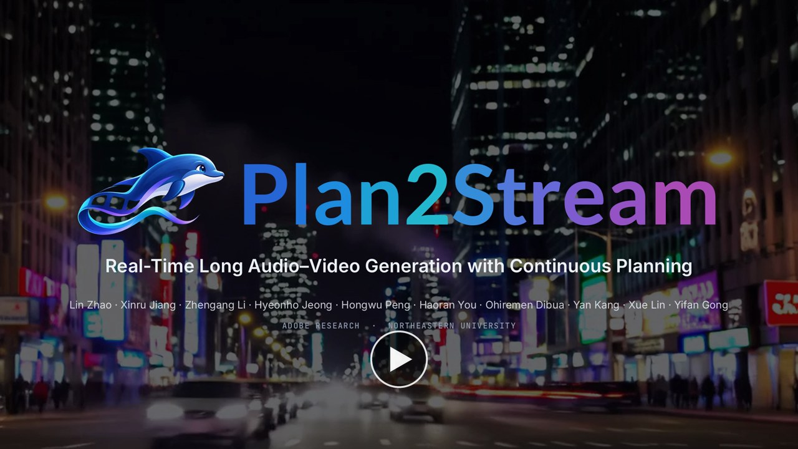

# Plan2Stream: Real-Time Long Audio-Video Generation with Continuous Planning.

<p align="center">
  <a href="https://lin-zhao-resolve.github.io/Plan2Stream/#video">
    
  </a>
  <br>
  <a href="https://lin-zhao-resolve.github.io/Plan2Stream/#video"><b>▶ Watch the video</b></a> ·
  <a href="https://github.com/lin-zhao-resoLve/Plan2Stream/releases/download/assets-v1/plan2stream-film.mp4">Download MP4</a> ·
  <a href="https://lin-zhao-resolve.github.io/Plan2Stream/">Project page</a>
</p>


```
docs/            the site (GitHub Pages: deploy from branch `main`, folder `/docs`)
  index.html     page structure
  style.css      styles
  main.js        intro animation, task switchboard, players, method schematic
  media.json     generated manifest: release location, hero wall tiles, demo items
  method3d.html  generated by tools/make_method3d.py (embedded in the Method section)
tools/
  sources.json   picked source videos (internal paths; gitignored, local only)
  build_media.py encode sources → media/ and write docs/media.json
  upload_release.py  upload media/ as GitHub Release assets (tag assets-v1)
  serve.py       local preview (serves docs/ and media/)
  make_method3d.py  build docs/method3d.html (embedded 3D method schematic) from
                 "Planning ahead of synthesis (3D).html": English UI, dark theme, page-friendly scrolling
media/           encoded videos/posters (gitignored; published as release assets)
```
